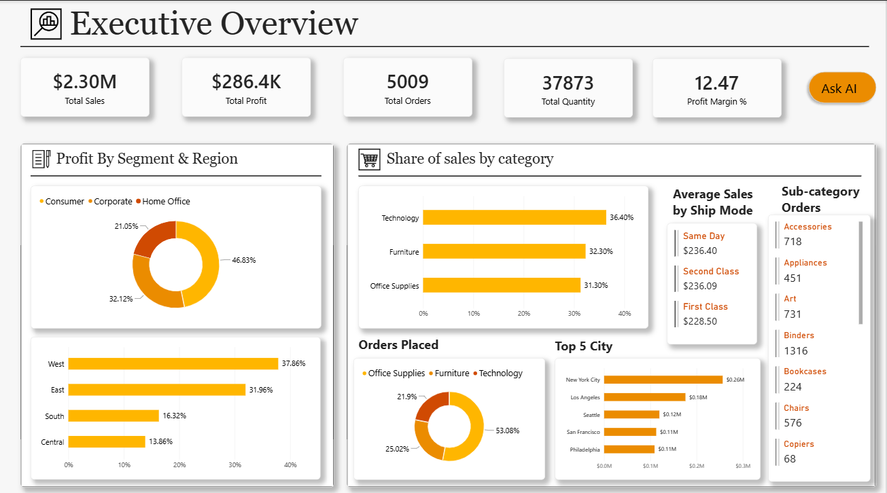
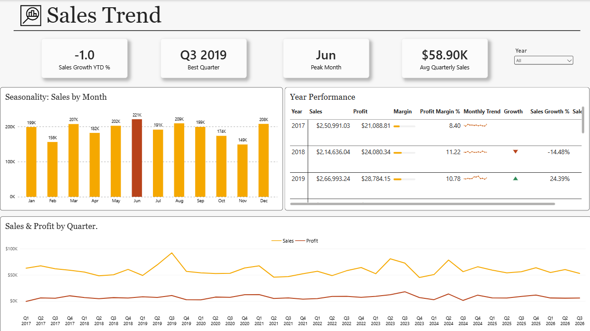
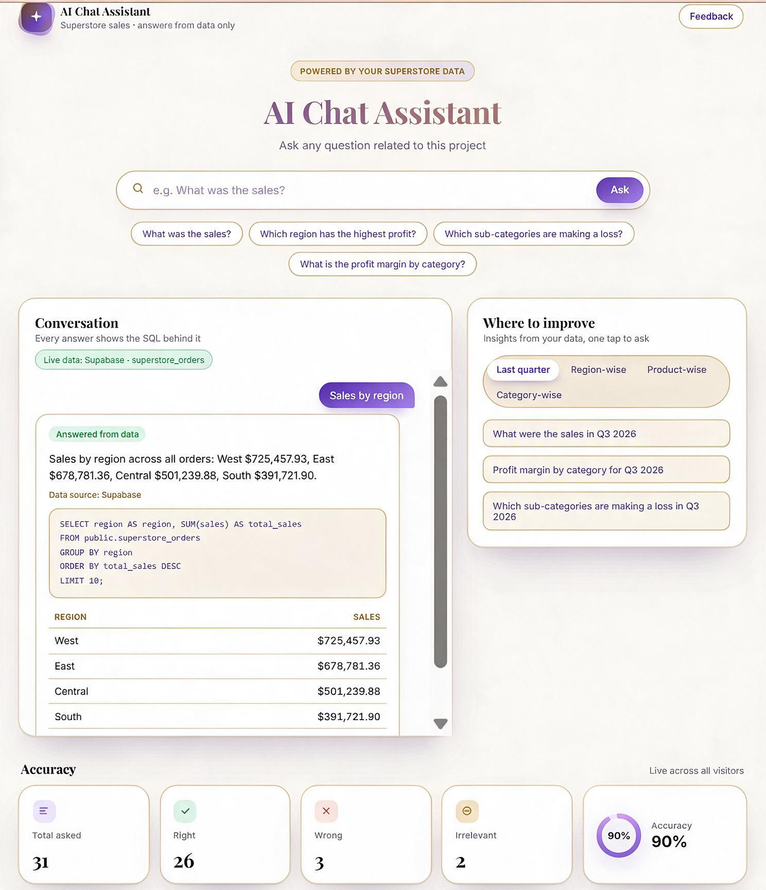
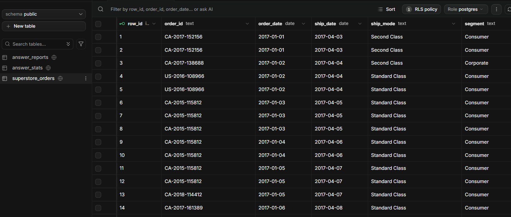
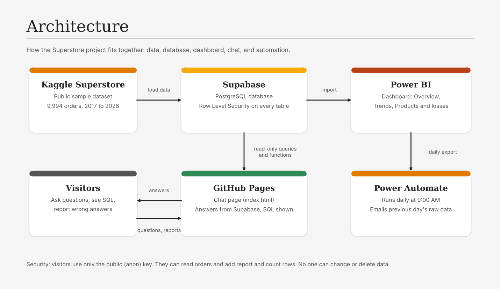
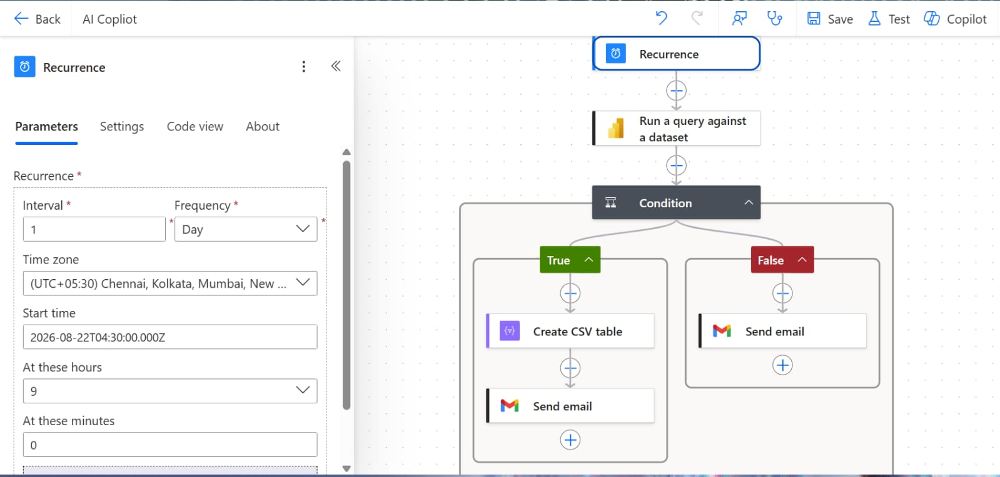

# Superstore Sales: Power BI Dashboard and AI Chat

An end-to-end analytics project: a Power BI report on a Superstore sales dataset, a Supabase database with read-only access, and a chat page that answers questions from that database and shows the SQL behind every answer.

**Live chat:** https://uday027.github.io/superstore-chat/

## Screenshots

| Overview | Trends |
|---|---|
|  |  |

| Chat with SQL | Supabase security |
|---|---|
|  |  |

## Architecture

- **Data:** Kaggle Superstore sample, loaded into Supabase.
- **Database:** Supabase (PostgreSQL) with Row Level Security. Visitors can only read `superstore_orders` and call read-only query functions.
- **Chat page:** a single HTML file on GitHub Pages. It calls Supabase with the public (anon) key.
- **Dashboard:** Power BI Desktop, imported from Supabase data.
- **Automation:** a Power Automate flow sends the previous day's raw data every morning.

## What it does

- **Executive Overview:** total sales, profit, margin, orders, quantity, sales by region and category.
- **Sales Trends:** quarterly sales and profit, margin over time, seasonality, and a year-by-year performance table with sparklines, progress bars, and growth indicators.
- **Ask a question:** type a question in plain English. The page answers from the database and shows the SQL it ran.
- **Report a wrong answer:** visitors can mark an answer as wrong and explain why. Reports are saved for review.
- **Daily summary:** a scheduled flow sends the previous day's raw data every morning.

## Questions the chat answers

- What was the total sales?
- Which region has the highest profit?
- Which sub-categories are making a loss?
- What is the profit margin by category?
- In the East region, which 5 products have the lowest sales?

Each answer shows the SQL it ran. You can copy it and run it in the Supabase SQL Editor.

## Power BI report

Open `report/superstore_dashboard.pbix` in Power BI Desktop (free). It uses the public sample data stored in the file, so no database connection is needed.

Pages: Overview, Trends, and Products and losses.

## Automation

A Power Automate flow runs every morning at 9:00 AM. It runs a query on the Power BI dataset, creates a CSV of the previous day's raw data, and emails it.

## Security

- Only the public (anon) key is in the page. It can read `superstore_orders` and add records to the accuracy and report tables. It cannot change or delete data.
- Row Level Security is enabled on every table.
- The chat uses fixed query functions. Visitors cannot send their own SQL.
- No customer names or IDs are included in the data.
- Database passwords, service keys, and API secrets are not in this repository.

## Data notes

- The dataset is a public Superstore sample.
- Order dates were adjusted to 2017 to 2026 for this project, so year and quarter results differ from the original file.
- 2026 covers January to September only.
- Totals: sales $2,297,201.07, profit $286,397.79, 5,009 orders.

## Limitations

- The chat's answers are rule-based. It understands common phrasings, not every possible question, so it may not answer every wording correctly.
- Free Supabase projects pause after 7 days of inactivity.

## Tools

Power BI Desktop, Supabase, PostgreSQL, SQL, DAX, HTML, CSS, JavaScript, GitHub Pages, Power Automate.

## Author

Uday Kumar
